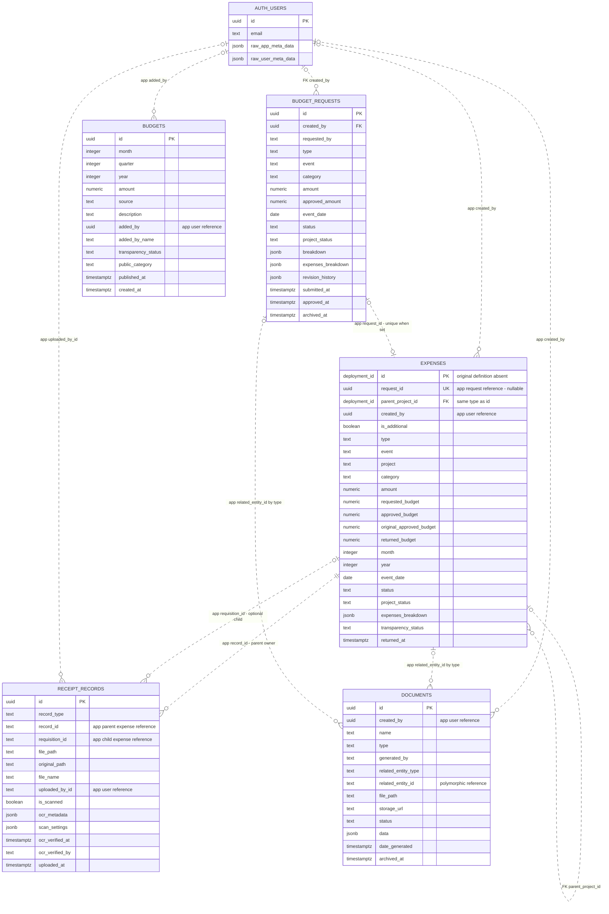
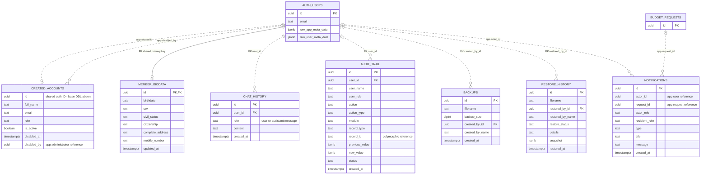
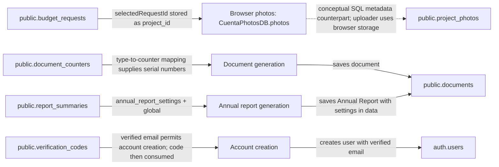
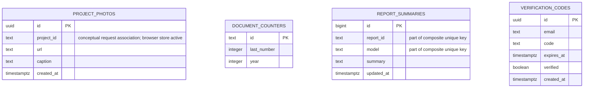

# Cuenta entity relationship diagram

Based on the SQL migrations and application code in this repository, reviewed September 29, 2026. This describes the repository's intended schema; the live Supabase database was not inspected. Fields are selected for readability, rather than an exhaustive column inventory.

Supporting-entity workflows were reviewed October 13, 2026. Their connected workflow diagram appears below. The [DBML diagram](ERD.dbml) keeps these SQL tables independent because the repository does not establish stored row references for them. Workflow dependencies and selector mappings must not be represented as column references. Only references named `fk_` represent confirmed database constraints; do not export `app_` references as SQL constraints.

`PK` means primary key, `FK` means a foreign key explicitly declared in the migrations, and `UK` means unique key. Relationships labeled `app` are application-level associations, not confirmed database foreign keys. Mermaid solid/dashed lines retain their standard identifying/non-identifying meaning; use the labels and FK markers to determine enforcement. `||` means exactly one, `o|` means zero or one, and `o{` means zero or many. Application relationship cardinalities describe intended use, not enforced referential integrity.

## Financial records and supporting documents

- Projects, events, payroll allocations, and recorded requisitions are represented by `expenses`. A requisition is a child expense with `is_additional = true` and `parent_project_id` pointing to its approved parent. Deleting a parent cascades to these child rows through the declared FK.
- Approval creates an expense associated with `budget_requests.id`. The partial unique index on `expenses.request_id` allows at most one expense per non-null request ID. The repository does not declare a request foreign key.
- `budgets` contains cumulative allocation entries. Multiple entries per month/year are intentional. Requests and expenses consume the period's available budget through date/period calculations; there is no `budget_id` column tying each expense to a single allocation row.
- Receipts belong to the approved parent through `record_id`. An optional `requisition_id` identifies the child line item. Both are text references without declared FKs.
- `documents.related_entity_id` is interpreted with `related_entity_type`: it may identify a request, an approved expense record, or a reporting year. The two displayed document relationships are alternatives, not simultaneous requirements.
- `deployment_id` is a diagram placeholder, not a PostgreSQL type. The migration deliberately derives `parent_project_id` from the deployed `expenses.id` type and mentions older BIGINT deployments. Confirm that type in the live database.

## Accounts, activity, and operations

`AUTH_USERS` denotes Supabase `auth.users`; the other entities are in `public`. Only relevant Auth fields are shown. User roles are stored in metadata and the account directory; there is no separate roles table in the repository. `chat_history.role` identifies a message speaker, not an officer role.

The account creation API writes `auth.users.id` into `created_accounts.id`. Its original CREATE TABLE statement is absent, so its primary key, uniqueness, and FK constraints cannot be confirmed from this repository. The `expenses` base CREATE TABLE is also absent; its ID key is inferred from the later self-referencing FK and application use.

Notifications target roles through `recipient_role`, not individual recipient user IDs. Audit targets are polymorphic `record_type`/`record_id` values. `restore_history` stores a filename and snapshot, with no declared `backup_id` relationship to `backups`.

## Supporting entities and logical connections

These tables were disconnected because their migrations declare no foreign keys. The connected view below shows how the application uses them. Arrows describe workflow dependencies; they do not assert required matching rows or referential integrity. The photo association describes the current browser store counterpart, rather than verified rows in `public.project_photos`.

| Supporting table | Workflow connection | Meaning and limits |
| --- | --- | --- |
| `project_photos` | Browser photos belong to `budget_requests` | Current browser photos store the selected **budget request** ID in `project_id`. The current uploader does not write the SQL table, so that relationship cannot be assumed for persisted SQL rows. |
| `document_counters` | Supplies numbers during document generation | Generation maps a document type to a counter ID. `documents.type` does **not** equal `document_counters.id`; a document stores no counter FK. |
| `report_summaries` | Supplies settings during annual-report generation | Annual Report generation loads the shared settings row with `report_id = 'annual_report_settings'` and `model = 'global'`. This is a dependency on settings, not a per-document summary reference. |
| `verification_codes` | Verifies email before creating `auth.users` | The verified email is used to create the account. A code may have no corresponding user, and successful account creation consumes it. The diagram does not assert email uniqueness or a required matching account. |

The document counter mapping is:

| `documents.type` | `document_counters.id` |
| --- | --- |
| `Purchase Request` | `pr_counter` |
| `Disbursement Voucher` | `dv_counter` |
| `Payroll` | `payroll_counter` |
| `Itinerary of Travel` | `itinerary_counter` |

Other document types do not use these counters. A number can be allocated without the preview ever being saved as a document. Shared annual-report settings can likewise exist without a saved report. These are reasons to keep the workflow lines distinct from database constraints.

To connect the SQL tables through actual stored references would require schema and application changes: confirm the target IDs in SQL photo rows before defining their relationship, store a counter reference on numbered documents, and introduce a report/settings reference for reports if that association needs to be persisted. A mandatory verification-code-to-user reference would prevent pre-account verification. These changes are outside this ERD-only update.

The SQL table fields remain:

- `project_photos` is defined in a migration with no FK. Current narrative report photos use browser IndexedDB through `src/utils/photoDB.js` and are keyed by `selectedRequestId` from `budget_requests`. The SQL table should not be assumed to hold those current photos or to reference `expenses` just because the column is called `project_id`.
- `document_counters` supplies document numbering through the mapping above; no document-to-counter FK is defined.
- `report_summaries` has a composite unique constraint on `(report_id, model)`. `report_id` is a text key, not a declared document reference. In particular, `annual_report_settings` is not a document UUID and must not be linked to `documents.id` as a foreign key.
- `verification_codes` identifies verification attempts by email and may exist before an Auth account is created. No user FK is defined. Requiring an existing user would prevent the current signup workflow.
- Public transparency views and Storage buckets are derived views and file infrastructure, respectively, rather than additional business entities in this diagram.

## Source references

- [Budget requests](../supabase/migrations/20260803120000_create_budget_requests_table.sql), [approval and notifications](../supabase/migrations/20260804100000_atomic_budget_approval.sql), [monthly allocations](../supabase/migrations/20260821190000_budget_allocation_history.sql).
- [Expense parent FK](../supabase/migrations/20260822200000_project_event_recorded_expenses.sql), [receipt requisition association](../supabase/migrations/20260822213000_consolidate_requisitions.sql), [returned budgets](../supabase/migrations/20260903000000_return_unused_budget_on_completion.sql).
- [Receipt records](../supabase/migrations/create_receipt_records.sql), [scan metadata](../supabase/migrations/20260819160000_receipt_scan_metadata.sql), [document associations](../supabase/migrations/20260821210000_document_tracking_metadata.sql).
- [Account creation](../api/create-user.js), [biodata](../supabase/migrations/create_member_biodata.sql), [chat](../supabase/migrations/create_chat_history_table.sql), [audit and backup tables](../supabase/migrations/audit_trail_and_backup_tables.sql).
- [Document generation](../src/components/DocumentGenerator.jsx), [narrative report photos](../src/pages/NarrativeReportPage.jsx), [annual report settings](../src/pages/AnnualReportPage.jsx).
- [Photo metadata table](../supabase/migrations/create_project_photos_storage.sql), [browser photo store](../src/utils/photoDB.js), [counter table](../supabase/migrations/create_document_counters.sql), [summary table](../supabase/migrations/create_report_summaries.sql), [verification-code table](../supabase/migrations/20260818225500_verification_codes.sql).
- [Voucher numbering](../src/components/documents/DisbursementVoucherForm.jsx), [payroll numbering](../src/components/documents/PayrollForm.jsx), [travel numbering](../src/components/documents/ItineraryOfTravelForm.jsx), [OTP generation](../api/send-otp.js), [chairman signup](../api/register-chairman.js).
