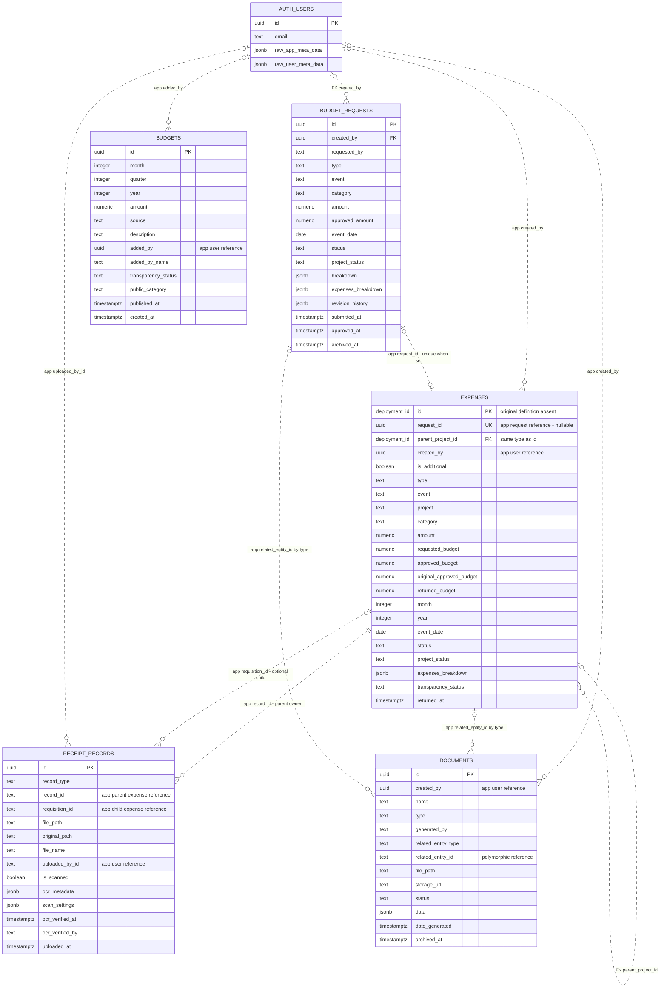
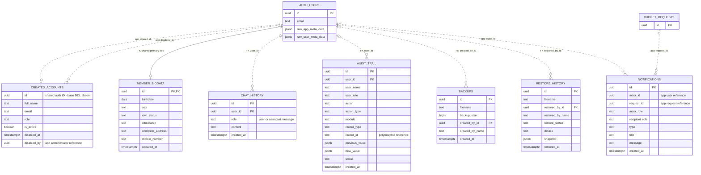
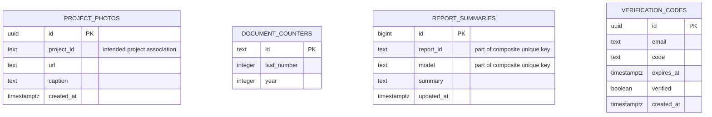

# Cuenta entity relationship diagram

Based on the SQL migrations and application code in this repository, reviewed September 29, 2026. This describes the repository's intended schema; the live Supabase database was not inspected. Fields are selected for readability, rather than an exhaustive column inventory.

`PK` means primary key, `FK` means a foreign key explicitly declared in the migrations, and `UK` means unique key. Relationships labeled `app` are application-level associations, not confirmed database foreign keys. Mermaid solid/dashed lines retain their standard identifying/non-identifying meaning; use the labels and FK markers to determine enforcement. `||` means exactly one, `o|` means zero or one, and `o{` means zero or many. Application relationship cardinalities describe intended use, not enforced referential integrity.

## Financial records and supporting documents

- Projects, events, payroll allocations, and recorded requisitions are represented by `expenses`. A requisition is a child expense with `is_additional = true` and `parent_project_id` pointing to its approved parent. Deleting a parent cascades to these child rows through the declared FK.
- Approval creates an expense associated with `budget_requests.id`. The partial unique index on `expenses.request_id` allows at most one expense per non-null request ID. The repository does not declare a request foreign key.
- `budgets` contains cumulative allocation entries. Multiple entries per month/year are intentional. Requests and expenses consume the period's available budget through date/period calculations; there is no `budget_id` column tying each expense to a single allocation row.
- Receipts belong to the approved parent through `record_id`. An optional `requisition_id` identifies the child line item. Both are text references without declared FKs.
- `documents.related_entity_id` is interpreted with `related_entity_type`: it may identify a request, an approved expense record, or a reporting year. The two displayed document relationships are alternatives, not simultaneous requirements.
- `deployment_id` is a diagram placeholder, not a PostgreSQL type. The migration deliberately derives `parent_project_id` from the deployed `expenses.id` type and mentions older BIGINT deployments. Confirm that type in the live database.

## Accounts, activity, and operations

`AUTH_USERS` denotes Supabase `auth.users`; the other entities are in `public`. Only relevant Auth fields are shown. User roles are stored in metadata and the account directory; there is no separate roles table in the repository. `chat_history.role` identifies a message speaker, not an officer role.

The account creation API writes `auth.users.id` into `created_accounts.id`. Its original CREATE TABLE statement is absent, so its primary key, uniqueness, and FK constraints cannot be confirmed from this repository. The `expenses` base CREATE TABLE is also absent; its ID key is inferred from the later self-referencing FK and application use.

Notifications target roles through `recipient_role`, not individual recipient user IDs. Audit targets are polymorphic `record_type`/`record_id` values. `restore_history` stores a filename and snapshot, with no declared `backup_id` relationship to `backups`.

## Other persisted entities

- `project_photos` is defined in a migration with no FK. The current narrative report implementation stores photos in browser IndexedDB (`CuentaPhotosDB.photos`) through `src/utils/photoDB.js`, so the SQL table should not be assumed to hold those current photos.
- `document_counters` supplies document numbering; no document-to-counter FK is defined.
- `report_summaries` has a composite unique constraint on `(report_id, model)`. `report_id` is a text key, not a declared document reference; the annual report also uses this table for settings.
- `verification_codes` identifies verification attempts by email and may exist before an Auth account is created. No user FK is defined.
- Public transparency views and Storage buckets are derived views and file infrastructure, respectively, rather than additional business entities in this diagram.

## Source references

- [Budget requests](../supabase/migrations/20260803120000_create_budget_requests_table.sql), [approval and notifications](../supabase/migrations/20260804100000_atomic_budget_approval.sql), [monthly allocations](../supabase/migrations/20260821190000_budget_allocation_history.sql).
- [Expense parent FK](../supabase/migrations/20260822200000_project_event_recorded_expenses.sql), [receipt requisition association](../supabase/migrations/20260822213000_consolidate_requisitions.sql), [returned budgets](../supabase/migrations/20260903000000_return_unused_budget_on_completion.sql).
- [Receipt records](../supabase/migrations/create_receipt_records.sql), [scan metadata](../supabase/migrations/20260819160000_receipt_scan_metadata.sql), [document associations](../supabase/migrations/20260821210000_document_tracking_metadata.sql).
- [Account creation](../api/create-user.js), [biodata](../supabase/migrations/create_member_biodata.sql), [chat](../supabase/migrations/create_chat_history_table.sql), [audit and backup tables](../supabase/migrations/audit_trail_and_backup_tables.sql).
- [Document generation](../src/components/DocumentGenerator.jsx), [narrative report photos](../src/pages/NarrativeReportPage.jsx), [annual report settings](../src/pages/AnnualReportPage.jsx).
